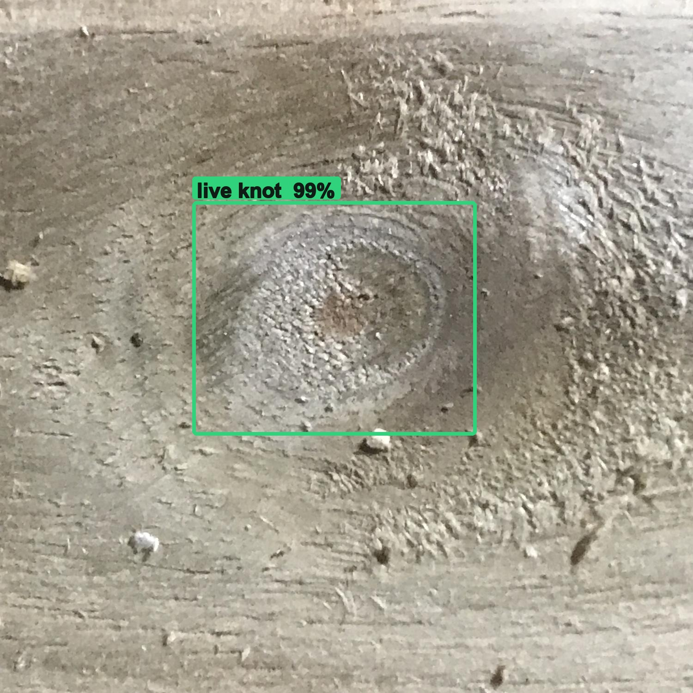
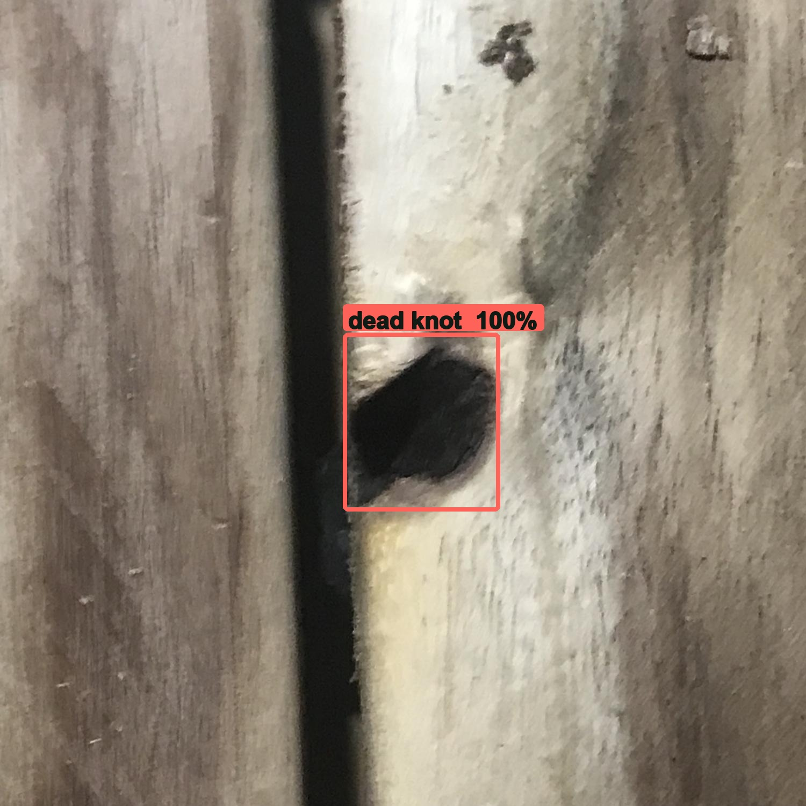
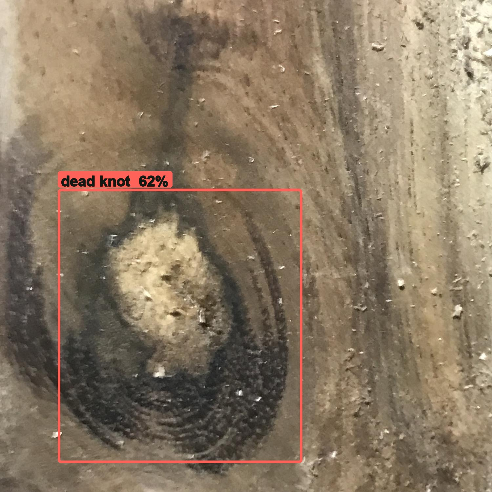
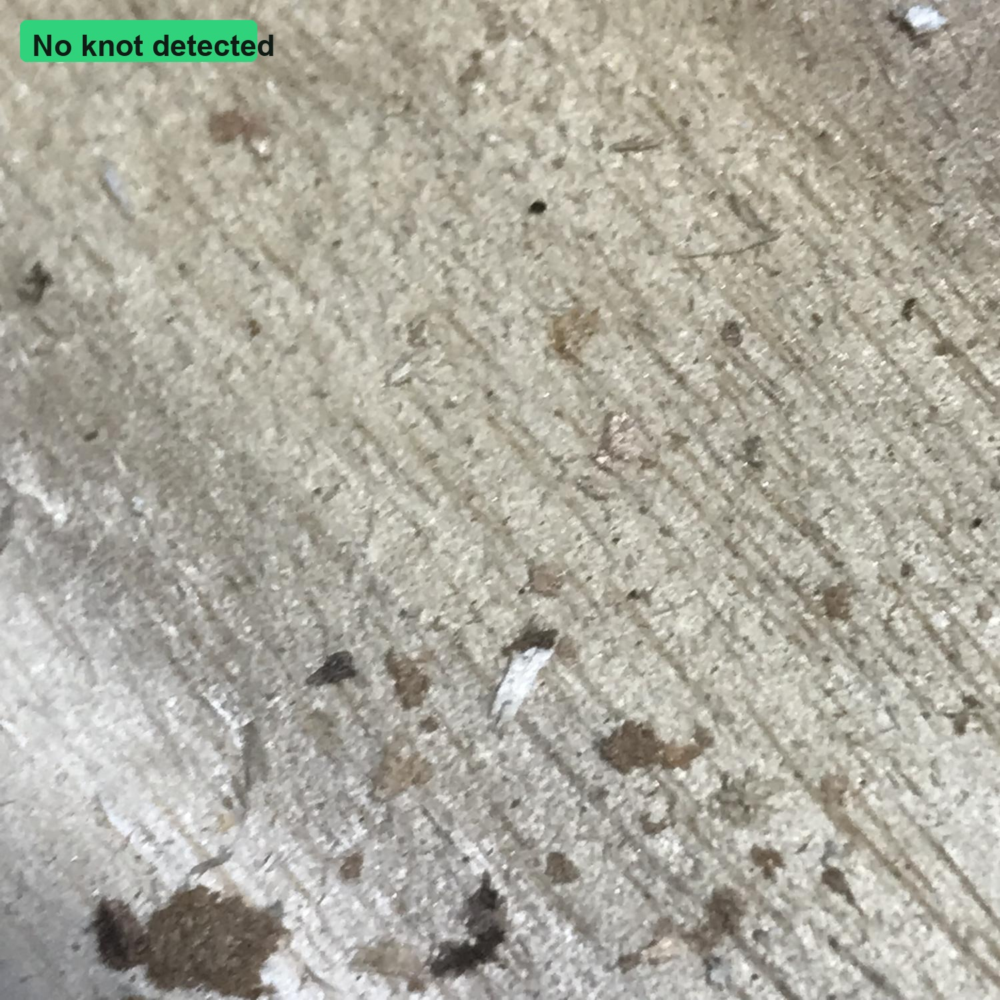
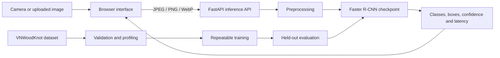

# TimberSight

**Real-time wood-knot detection from a camera or uploaded image.**

TimberSight is an end-to-end computer-vision system by
**Hilfritz Camallere**. It demonstrates how an object-detection experiment can
be taken from dataset validation and reproducible training to a browser-based
inspection application with measured results and documented limitations.

[](demo_images/demo2_polished.mp4)

**[Watch the 25-second demo](demo_images/demo2_polished.mp4)** — camera input,
continuous inspection, bounding-box overlays and live inference results.

## Results at a glance

The Faster R-CNN baseline was selected using validation performance and then
evaluated once on the untouched 229-image test split.

| Metric | Held-out test result |
| --- | ---: |
| Overall mAP50 | **0.9040** |
| Live-knot AP50 | **0.9031** |
| Dead-knot AP50 | **0.9050** |
| Mean CPU inference latency | **64.1 ms/image** |

The AP implementation uses one-to-one matching at IoU 0.50 and includes false
positives from knot-free images. These figures are not COCO AP50:95 and are not
claims of production-line performance. See [the complete results](docs/RESULTS.md)
and [model card](MODEL_CARD.md).

## What this project demonstrates

- **Computer vision:** two-class object detection with PyTorch, TorchVision and
  a Faster R-CNN MobileNetV3-FPN model.
- **Data engineering:** schema validation, corrupt-image detection, annotation
  checks, split-leakage checks and dataset profiling.
- **Reproducible ML:** fixed splits, versioned configuration, deterministic
  sampling, held-out evaluation and checkpoint hashing.
- **Application engineering:** a FastAPI inference API plus a responsive browser
  interface for image upload, camera capture and continuous inspection.
- **Quality practices:** automated tests, GitHub Actions, technical decisions,
  measured results and explicit deployment limitations.

## Example detections

| Live knot | Dead knot |
| --- | --- |
|  |  |
| Challenging surface | Knot-free negative |
|  |  |

## System flow



Only one inference request is kept in flight during live inspection. This
prevents a slow device from accumulating stale camera frames.

## Dataset

TimberSight uses
[VNWoodKnot](https://doi.org/10.17632/vnst548g5n.1), a CC BY 4.0 dataset with
1,515 wood-surface images:

- 1,015 positive images containing live or dead knots;
- 500 knot-free images retained as negative examples; and
- 1,021 annotated knot objects.

The dataset article is available at
[DOI 10.1016/j.dib.2025.112039](https://doi.org/10.1016/j.dib.2025.112039).
Raw data and trained weights are intentionally excluded from Git. See
[data/README.md](data/README.md) for the expected local layout and
[docs/DATA_PROFILE.md](docs/DATA_PROFILE.md) for the verified profile.

## Quick start

### 1. Install everything

Run the installer from the repository root:

```bash
./script_timbersight_install.sh
```

The installer checks for Python 3.11 or newer, creates `.venv` when needed, and
installs the development, PyTorch/TorchVision and web dependencies into that
environment. It does not modify the system Python installation.

Environment activation is **not required** when using the supplied start, stop,
status and open scripts because they call `.venv/bin/python` directly. Activate
the environment before running the Python and TimberSight commands below:

```bash
source .venv/bin/activate
```

<details>
<summary>Manual installation alternative</summary>

```bash
python3 -m venv .venv
source .venv/bin/activate
python -m pip install --upgrade pip
python -m pip install -e ".[dev,ml]" -r requirements-web.txt
```

</details>

### 2. Run the tests

Tests do not require the full dataset or trained checkpoint.

```bash
python -m pytest
```

### 3. Prepare and validate the dataset

Download VNWoodKnot, follow the layout in [data/README.md](data/README.md), and
configure its local path in `config/dataset.toml`. Then validate and profile it:

```bash
timbersight-validate --config config/dataset.toml
timbersight-profile \
  --config config/dataset.toml \
  --json-output artifacts/data-profile.json \
  --markdown-output docs/DATA_PROFILE.md
```

### 4. Train and evaluate

```bash
timbersight-train \
  --dataset-config config/dataset.toml \
  --train-config config/train.toml

timbersight-evaluate \
  --dataset-config config/dataset.toml \
  --checkpoint artifacts/runs/RUN_ID/model.pt \
  --split test \
  --device cpu \
  --output artifacts/runs/RUN_ID/test-metrics.json
```

Use the test split only after selecting a checkpoint from validation results.

### 5. Run the camera application

Point `TIMBERSIGHT_CHECKPOINT` to a trained checkpoint, then use the helper:

```bash
export TIMBERSIGHT_CHECKPOINT="artifacts/runs/RUN_ID/model.pt"
./script_timbersight_start.sh
```

The helper starts the service and opens the website. Other commands are:

```bash
./script_timbersight_check.sh
./script_timbersight_open.sh
./script_timbersight_stop.sh
```

See [WEB_APP.md](WEB_APP.md) for API usage, processor selection and manual
startup instructions.

## Repository guide

| Path | Purpose |
| --- | --- |
| `src/timbersight/data/` | Dataset validation and profiling |
| `src/timbersight/modeling/` | Dataset adapter, training and evaluation |
| `src/timbersight/inference.py` | Reusable checkpoint inference |
| `src/timbersight/web/` | FastAPI service and browser interface |
| `config/` | Versioned dataset and training configuration |
| `tests/` | Automated data, metric and inference tests |
| `script_timbersight_install.sh` | Creates `.venv` and installs every dependency |
| `docs/RESULTS.md` | Experiment identity, metrics and interpretation |
| `MODEL_CARD.md` | Intended use, reproducibility and limitations |
| `docs/TECHNICAL_DECISIONS.md` | Engineering trade-offs and rationale |

## Scope and limitations

TimberSight is an experimental computer-vision prototype, not a production lumber
grader. It has not been validated across sawmill cameras, wood species,
production lighting, conveyor motion or industrial safety conditions. It does
not assess structural strength, determine lumber grade, process point clouds or
perform 3D calibration. Production use would require representative site data,
robustness testing, confidence calibration, monitoring and safe failure modes.

## Roadmap

- [x] Validate and profile VNWoodKnot.
- [x] Train and evaluate a reproducible two-class detector.
- [x] Provide image-upload and camera-based inference.
- [x] Add continuous live inspection, an API and browser overlays.
- [x] Publish tests, CI, results, model documentation and a demo video.
- [ ] Benchmark lighting, blur, motion and perspective changes.
- [ ] Calibrate confidence thresholds against operational costs.
- [ ] Validate with external cameras, wood species and production-site data.
- [ ] Add a C#/.NET integration client and persistent inspection records.
- [ ] Explore 3D geometry, calibration and point-cloud inputs.

## Author

**Hilfritz Camallere** — Master of Data Analytics and software engineer focused
on computer vision, machine learning and production application development.
